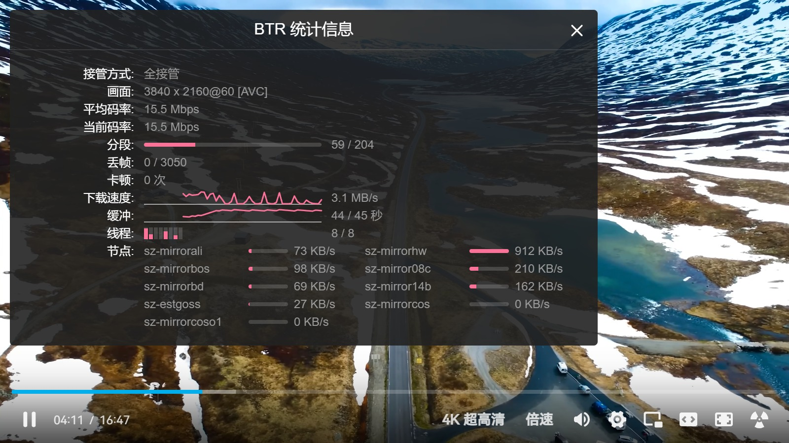
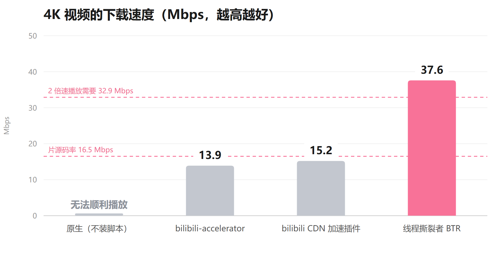
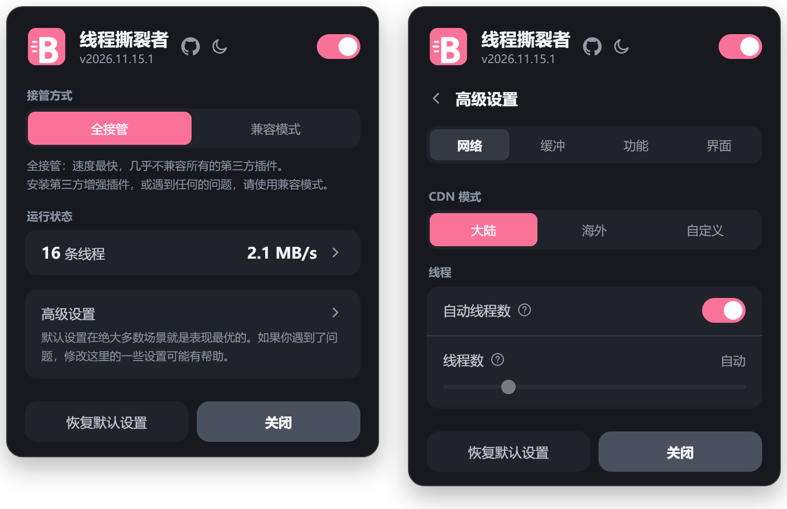
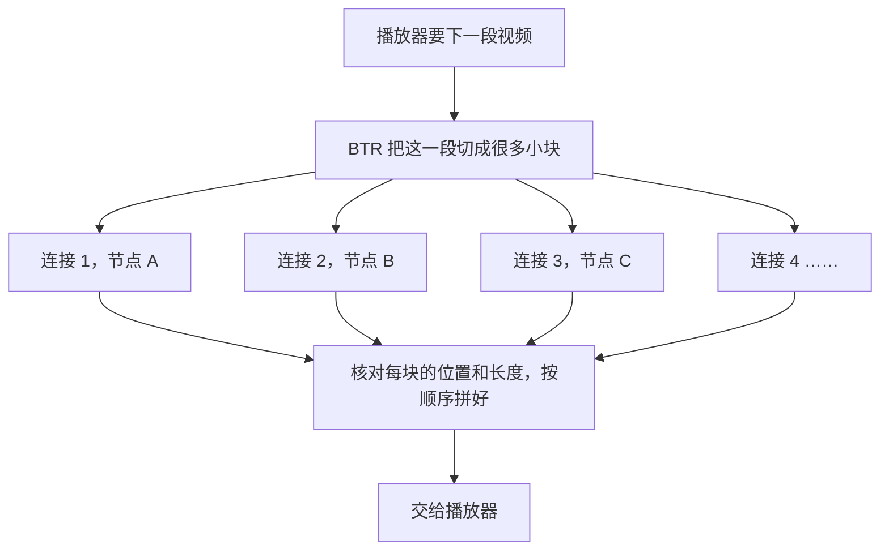
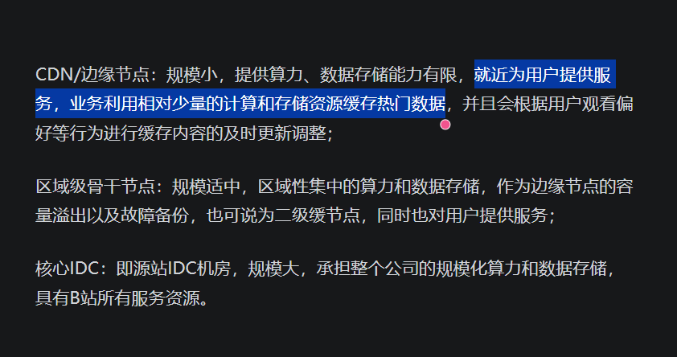

# Bilibili 线程撕裂者

### 强大的海外 B 站卡顿优化脚本

Bilibili Thread Ripper脚本，简称 BTR。把视频拆成小块，多线程从多个 CDN 节点同时下载，不只是换个 CDN。 在海外也能流畅播放 4K、8K 和杜比视界。

Bilibili Thread Ripper (BTR): a userscript that fixes Bilibili buffering outside mainland China by downloading each video in parallel from multiple CDN nodes.

  

 

[效果](#效果) | [安装](#安装) | [设置](#设置) | [原理](#原理) | [其他平台](#其他平台) | [常见问题](#常见问题) | [更新日志](CHANGELOG.md)

在播放器上右键打开的 BTR 统计信息：一个 4K60 视频正由 8 条线程从多个 CDN 节点同时下载

## 效果

对比原生以及其他优化插件，墨尔本，运营商 Superloop 实测。测试视频是一个仅自己可见、几乎无播放的 4K60 视频（BV1Aou3zjEh1），3 次测试取平均，线程撕裂者版本 2026.10.8.1。仅能代表当时的测试结果，仅供参考。

## 功能

- **多线程与多节点下载**：智能多线程和多节点并行下载，并合理分配各个节点的下载资源。
- **自动线程数**：按网络情况调整最佳选项。
- **两种接管方式**：支持替换播放器核心的全接管模式，以及让BTR适应播放节奏的兼容模式 使其兼容第三方插件。
- **剧集和直播**：支持剧集，番剧，直播加速。
- **调整缓冲策略**：支持调整缓冲的时长，绕过浏览器视频缓冲限制。
- **阻止使用国际版**：支持阻止海外自动跳转国际版网页
- **没有遥测**：不上传任何数据。

## 安装

1. 安装脚本管理器：[暴力猴 Violentmonkey](https://violentmonkey.github.io/)（推荐）或 [Tampermonkey](https://www.tampermonkey.net/)。部分用户反馈 Tampermonkey 正式版有时接管不稳定，换 beta 版可以解决。
2. **Chrome、Edge 等 Chromium 内核浏览器必做**：扩展管理 → 暴力猴（或 Tampermonkey）→ 详情 → 打开 **允许运行用户脚本**（老版本是打开 **开发者模式**）。

   

   
找不到？看动图

   

   

3. 安装脚本：

   

4. 打开任意 B 站视频，页面右下角出现 BTR 悬浮球就装好了。你可以在脚本管理器内更新脚本。

| 浏览器 | 支持 | 建议 | 说明 |
| --- | :---: | --- | --- |
| Chrome、Edge 等 Chromium 内核 | ✅ | [暴力猴插件](https://violentmonkey.github.io/) | 一定要打开“允许运行用户脚本” |
| Firefox | ✅ | [暴力猴插件](https://violentmonkey.github.io/) | |
| Safari | ✅ | [Tampermonkey](https://www.tampermonkey.net/) | 建议在设置里选择兼容模式 |

> [!WARNING]
> 如果你是早期通过视频了解到这个插件的：针对 Chrome 的独立插件版已经停止更新。请先在扩展管理里移除插件版，再按上面的步骤安装油猴脚本版，不要同时开启两个版本。

## 设置

默认设置就是最优的，如需修改，点页面上的 **BTR 悬浮球**，或者脚本管理器菜单里的 **线程撕裂者设置**

## 原理

B 站网页播放器下视频，一段数据只开一条连接。海外看冷门视频时这条连接经常只有几 Mbps，码率一高就卡。BTR 把这一段再切成很多小块，分给多条连接、多个节点一起下，下完核对位置，再按顺序拼起来交给播放器。

每条连接下的是文件里不同的部分，不会把同一个文件下好几遍。哪一块回来的位置或长度不对，直接丢掉，不会塞进播放器。

<b>为什么用大陆 CDN</b>

B 站官方在 [《B站公网架构实践及演进》](https://www.bilibili.com/opus/740129406252482739) 里讲过他们的 CDN 分层，下面是原文截图：

边缘节点离你近但容量小，只缓存热门视频；区域节点容量大，给边缘节点兜底；核心机房存着所有视频。所以海外看热门视频很快，冷门视频在海外边缘节点上没有缓存，要绕回国内去取，一条连接就慢得不行。这是按官方架构推出来的，不代表每个视频、每条线路都这样。

大陆 CDN 模式就是直接去大陆节点拿数据，不在海外没缓存的节点上干等。大陆离得远，单条连接还是慢，所以要和多线程一起用。

<b>多线程下载调度：不只是多开几个线程</b>

线程撕裂者不是简单地把一个视频开很多线程下载，而是在多个 CDN 之间做了一套为播放服务的调度。

早期线程撕裂者由于效率低，采用堆砌线程方法来提升速度，随着版本优化，最新的线程撕裂者的内核更接近于下载调度器。它会一直测每个 CDN 的实际速度、响应时间和稳定性，据此决定开多少线程、每个节点分多少数据、每块切多大。某一块中途断了，就从已经下到的位置接着下，不用整块重来。离播放越近的数据越先下，带宽先留给马上要播的内容；只有判断某个请求可能赶不上播放时，才会找别的节点再发一份去救，尽量不浪费流量。

另外它还会管浏览器缓冲区的容量和下载地址的签名过期；出问题的 CDN 先降级，过一会儿再重新试；接管时让 B 站自己的下载调度器停下来，免得两边重复下载。直播里则是节点竞速加限流预取，把快要播的分片提前准备好。

<b>直播加速（实验性）</b>

BTR 的直播加速刚刚开始适配，还在探索中，效果可能有限，没有视频那么明显。后面会继续优化。

live.bilibili.com 的直播间也可以由 BTR 接管下载：在设置里打开“直播加速”（默认关闭）。直播和点播的卡顿原因不一样：直播分片是一秒一片实时产生的，没法像点播那样往前猛下，但是海外分到的直播节点质量参差不齐、经常波动，网页播放器还会开 P2P 从其他观众那里拉数据，海外观众稀少时反而更卡。所以直播模块做的是：

- 屏蔽直播 P2P 和 PCDN 中转，只走官方节点；
- 每个分片在多个官方节点之间竞速，慢了 0.4 秒就开备份副本，坏节点整场停用；
- 提前下载 playlist 里已经宣告的分片，播放器来取的时候直接给，实测分片等待时间中位数可以降到 0。

直播只处理 fMP4 HLS 流（网页播放器默认使用的格式）。

<b>和 B 站播放器的分工</b>

全接管模式下，BTR 直接把数据写进网页里的播放器，B 站的界面、弹幕、清晰度菜单都照常用；兼容模式下还是 B 站播放器自己放，BTR 只帮它下载。

BTR 使用 B 站原生播放器界面，不自己重复造一套播放器。播放器功能归播放器，加速功能归线程撕裂者，少互相干扰：

| B 站播放器继续负责 | 线程撕裂者只负责 |
| --- | --- |
| 清晰度和编码选择 | 媒体下载 |
| 弹幕显示、发送和弹幕设置 | CDN 路线 |
| 字幕、自动生成字幕和字幕切换 | 并发 Range |
| 倍速、音量、画中画和全屏 | 缓冲 |
| 合集、分 P、自动连播和站内切换 | 失败重试 |
| B 站自己的快捷键与播放器设置 | |

## 其他平台

| 项目 | 平台 | 作者 |
| --- | --- | --- |
| [Bilibili-thread-ripper-desktop](https://github.com/MrTangLuyao/Bilibili-thread-ripper-desktop) | Windows 哔哩哔哩客户端 | LouieTang |
| [Bilibili-thread-ripper-mac](https://github.com/Katsurama/Bilibili-thread-ripper-mac) | macOS 哔哩哔哩客户端 | Katsurama |
| [BiliFast](https://github.com/KaiC5504/BiliFast) | iOS | KaiC5504 |
| [MyTVB-Speed-Boost](https://github.com/nitansde/MyTVB-Speed-Boost) | Android TV | nitansde |
| [PiliPlus 海外加速版](https://github.com/lemonteaau/PiliPlus) | Android、iOS、Windows、macOS、Linux | lemonteaau |
| [PiliPlus-BTR](https://github.com/nishuodedui1145-del/PiliPlus) | Android、iOS | nishuodedui1145-del |

这些项目由社区独立维护，效果不做保证。

## 常见问题

<b>和 CDN 优选（CDN 替换）插件有什么区别？</b>

CDN 优选插件测几个节点，挑最快的一个，把播放地址换过去，下载一般还是一条连接，冷门视频照样可能卡。BTR 把每段视频拆成小块，用多条连接从多个节点同时下载。2026 年 10 月的实测见[效果](#效果)，那些插件之后可能有变化。

<b>能不能解除地区、会员或者登录限制？</b>

不能。线程撕裂者只会优化你已经有权访问的媒体字节，不负责绕过任何播放权限。

<b>全接管和兼容模式是什么意思？</b>

对于普通用户，建议开启全接管模式；一个例外是 Safari 用户，建议开启兼容模式以避免一些播放问题。

全接管模式会接管更多的播放器底层功能，自己重写了部分播放器的底层运行模式。如果遇到了任何播放问题，比如跳帧、部分设置不生效，建议开启兼容模式：这个模式尽量不改写 B 站的播放器，而是让 BTR 去适配它。

如果你是桌面版 BTR 的用户，则没有这个选项：桌面版强制工作在类似网页版兼容模式的方式下，这是为了更好的版本兼容性。

<b>为什么设置 32 线程却没有一直显示 32？</b>

`32` 是并发上限，不是要求 BTR 每一秒都塞满 32 条连接。媒体分段较小、缓存足够、请求刚完成或者音视频任务数量变化时，真实线程数都会下降。

<b>为什么第一次打开视频可能比热门视频原生起播慢一点？</b>

这个问题在兼容模式和桌面版的部分视频中更明显，但我相信这是值得的。BTR 要先读取音视频索引、确认可用节点并准备一段连续缓存。这个过程会有额外开销，目的是避免高码率视频刚播两秒就开始转圈。

<b>自动播放开关失效？</b>

这个 Bug 已经在最新版本中修复，如果是旧版用户记得更新。但是部分用户依旧反馈会出现。如果你在最新版中依旧遇到这个问题，解决办法是在设置中打开兼容模式。

<b>直播加速开启后感觉更卡了？</b>

目前直播加速在早期实验阶段，不如视频加速成熟，我们依旧在探索如何更好地加速直播。如果出现这种情况，建议关闭直播加速。

<b>播放视频时，右键“视频统计信息”里的数据很奇怪？</b>

这是正常的。B 站自带的统计信息读的是它自己的播放器，被 BTR 接管后那里的数据不准。想看实际情况，请右键选 **BTR 统计信息**。

<b>会不会上传 Cookie、播放记录或者视频内容？</b>

不会。BTR 没有遥测，也不会把视频内容上传到第三方服务器。媒体数据只进入当前页面的内存和浏览器媒体缓冲区。

<b>未来会提供手机或平板版吗？</b>

目前的结论是，为手机开发非侵入式的 BTR 很难。通过 Loon、圈 X、Clash 去改写手机 B 站的优化效果有限；可行的方案比如魔改 B 站客户端或第三方客户端，即使能开发出来，安装与维护的难度也很大。所以暂时不开发 BTR 手机版。社区已经有移植，见[其他平台](#其他平台)，也欢迎各路大神继续移植。

<b>还是卡，怎么反馈？</b>

只说一句“没效果”，基本没办法判断到底是节点、带宽、编码、权限还是 BTR 出错。如果你要反馈“还是卡”，最好一起提供这些信息：

- 浏览器和暴力猴（或 Tampermonkey）的版本，BTR 的版本
- 所在国家或地区，以及网络运营商
- 视频 BV 号、清晰度和编码
- CDN 模式与线程数
- BTR 设置里 **高级设置 → 功能 → 调试 → 诊断信息** 点 **复制** 得到的内容
- 是首次加载慢、连续播放卡，还是大幅拖动后卡

**请不要公开 Cookie、访问令牌或者完整的媒体签名地址。**

带上这些信息，到 [Issues](https://github.com/MrTangLuyao/Bilibili-thread-ripper/issues/new/choose) 反馈。

## 贡献

我个人能力有限，由衷希望各路大佬都来贡献代码、提提意见，我都会看的。希望有朝一日 B 站能优化好海外的 CDN，我们也不用搞这么多复杂的玩意了。

想改代码、提建议，或者抢先试用 Canary 测试版，请看[贡献指南](CONTRIBUTING.md)。

觉得有用，欢迎点个 Star，也分享给在海外看 B 站的朋友。

## 协议与声明

项目采用 [MIT 开源协议](LICENSE)。

本项目是非官方、实验性质的开源项目，不会绕过会员、登录、地区、清晰度、审核状态、数字版权保护或媒体签名限制。

本人最近比较忙，并且经常回国，所以收到反馈修复可能需要一段时间。同时我想为本项目找一个维护者，如果你感兴趣，可以跟我联系：louieluyaotang@gmail.com
